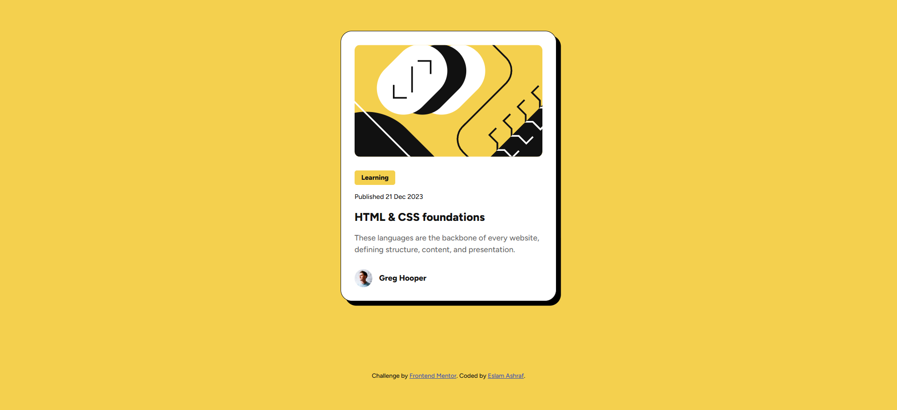

# Frontend Mentor - Blog preview card solution

This is a solution to the [Blog preview card challenge on Frontend Mentor](https://www.frontendmentor.io/challenges/blog-preview-card-ckPaj01IcS). Frontend Mentor challenges help you improve your coding skills by building realistic projects.

## Table of contents

- [Overview](#overview)
  - [The challenge](#the-challenge)
  - [Screenshot](#screenshot)
  - [Links](#links)
- [My process](#my-process)
  - [Built with](#built-with)
  - [What I learned](#what-i-learned)
  - [Continued development](#continued-development)
  - [Useful resources](#useful-resources)
  - [AI Collaboration](#ai-collaboration)
- [Author](#author)

## Overview

### The challenge

Users should be able to:

- See hover and focus states for all interactive elements on the page

### Screenshot



### Links

- Solution URL: [https://github.com/e5lama5hraf/blog-preview-card](https://github.com/e5lama5hraf/blog-preview-card)
- Live Site URL: [https://e5lama5hraf.github.io/blog-preview-card/](https://e5lama5hraf.github.io/blog-preview-card/)

## My process

### Built with

- Semantic HTML5 markup
- CSS custom properties
- Flexbox
- BEM-style class naming
- Mobile-first workflow
- Self-hosted variable font ([Figtree](https://fonts.google.com/specimen/Figtree))

### What I learned

**1. Hard offset shadow with no blur.** The card's solid black shadow is just a `box-shadow` with two offsets and no blur value. When no color is given, it falls back to the element's `color`, which is already black here:

```css
.card {
  border: 1px solid var(--gray-950);
  box-shadow: 8px 8px;
}
```

**2. Design tokens with CSS custom properties.** I stored the colors and repeated values in `:root` so the whole design can be changed from one place:

```css
:root {
  --yellow: hsl(47, 88%, 63%);
  --gray-950: hsl(0, 0%, 7%);
  --line: 1.5;
  --gutter: 1.5rem;
}
```

**3. Centering with CSS Grid.** Two lines on the `body` are enough to center the card both ways:

```css
body {
  display: grid;
  place-items: center;
  min-height: 100dvh;
}
```

**4. Using `gap` instead of margins.** With `flex-direction: column` and `gap`, spacing between the card's sections stays consistent without adding margins to every element.

**5. Shrink-to-fit tags.** Inside a flex column, children stretch to full width. `width: fit-content` keeps the "Learning" tag only as wide as its text.

**6. Semantic HTML and decorative images.** The card is inside `<main>`, the title is an `<h1>`, and the purely decorative images use an empty `alt=""` so screen readers skip them.

**7. Color contrast.** Yellow text on a white background is almost unreadable, so for the title's hover state I added an underline along with the color change, so the change doesn't depend on color alone.

**8. Font fallbacks.** `sans-serif` is a generic keyword, so it should not be wrapped in quotes:

```css
font-family: "Figtree", sans-serif;
```

### Continued development

- Making layouts fully fluid between 320px and large screens using `min()`, `clamp()` and relative units instead of fixed pixel widths.
- Testing color contrast earlier in the process, not after finishing.
- Practicing more with CSS Grid and building layouts with more than one component.

### Useful resources

- [MDN - box-shadow](https://developer.mozilla.org/en-US/docs/Web/CSS/box-shadow) - Helped me understand how the shadow offsets and default color work.
- [MDN - CSS custom properties](https://developer.mozilla.org/en-US/docs/Web/CSS/Using_CSS_custom_properties) - A clear guide for organizing colors and spacing as variables.
- [WebAIM Contrast Checker](https://webaim.org/resources/contrastchecker/) - Useful for checking whether text colors are readable.

### AI Collaboration

- **Tool:** Claude.
- **How I used it:** I used it as a code reviewer after finishing my solution, to catch accessibility issues, the font-family syntax mistake, and responsive-width problems.
- **What worked well:** Getting specific, explained feedback on my own code, so I could fix things myself and understand why.
- **What I kept in mind:** I wrote the HTML and CSS myself first and only then asked for a review.

## Author

- GitHub - [@e5lama5hraf](https://github.com/e5lama5hraf)
